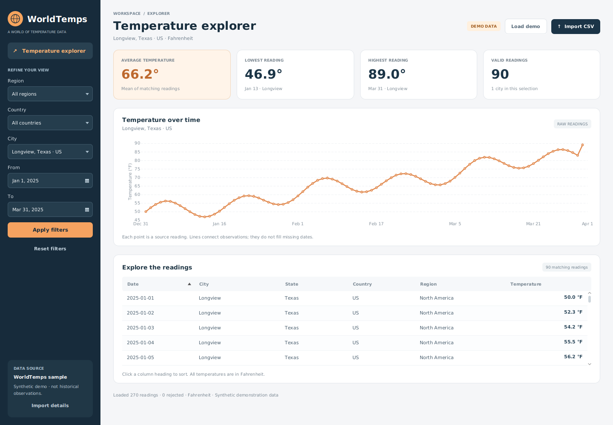

# WorldTemps

A Java temperature explorer with a JavaFX desktop dashboard and a reusable analysis
core. Filter daily readings by location and date, inspect trends, and explore the
underlying CSV data. This project began as linked-list coursework and now retains
that foundation behind a separate presentation and query layer.



## Run the desktop app

Requirements: **JDK 17+**, **Maven 3.9+**, and a graphical desktop session.
Maven downloads the JavaFX libraries for your operating system.

```sh
mvn clean verify
mvn javafx:run
```

The app opens a synthetic sample with 270 readings: 90 daily observations each for
Longview, London, and Tokyo, from January 1 through March 31, 2025. These values are
**invented demonstration data in Fahrenheit**, not historical observations or
forecasts. Longview is selected initially so the chart is immediately useful.

Use **Import CSV** to explore your own dataset. Imports run on a background thread.
If an import fails or has no valid readings, the previous dataset remains available.
The source panel and import details distinguish accepted and rejected records.

### Dashboard features

- Region and country filters narrow the available city choices.
- City labels include state and country to distinguish identical names.
- Inclusive date filters; blank dates mean no date bound.
- Average, minimum, maximum, and count cards calculated from the same filtered
  readings shown in the table.
- A city temperature chart with actual date spacing and hover details for readings.
- A sortable table with numeric temperature sorting and calendar date sorting.
- Clear empty results, invalid-date feedback, reset, and demo reload controls.
- Keyboard-accessible standard controls and a scrollable layout for smaller windows.

Change your filters, then click **Apply filters**. **Reset filters** shows all
matching locations. When All cities is selected, summaries and the table include
all matches, while the chart asks you to select a city rather than connecting
unrelated locations into one trend.

The chart displays raw source readings. Lines connect observations and do not
imply data exists for missing dates. Duplicate source readings are retained; no
daily/monthly aggregation is applied. For large selections the chart shows the
first 1,000 matching readings and displays that limit explicitly. The table and
summary cards continue to include every matching record.

## Console interface

The existing console workflow remains available as a separate executable JAR:

```sh
mvn clean verify
java -jar target/worldtemps.jar
java -jar target/worldtemps.jar /path/to/city_temperature.csv
java -jar target/worldtemps.jar --help
```

The JAR bundles its CSV dependencies and demo data, so it works from any working
directory. It is the **console** distribution; use `mvn javafx:run` for the desktop
interface. A native desktop installer is not included in this milestone.

## CSV contract

UTF-8 CSV with a header containing these columns. Order and capitalization may vary:

```csv
Region,Country,State,City,Month,Day,Year,AvgTemperature
North America,US,Texas,Longview,1,1,2025,45.0
Europe,UK,,London,1,1,2025,38.0
```

Temperatures are interpreted as **Fahrenheit**. The original dataset's `-99`
missing-temperature marker is excluded. An actual value of -99 °F therefore cannot
be imported using this format; other finite negative temperatures are valid.
Dates must be calendar-valid. Region, country, and city are required; state may be
blank. Location labels are matched as supplied (`US` and `United States` are
separate labels).

Quoted commas and escaped quotes are supported. Invalid individual records are
skipped and counted. Missing required headers or malformed CSV quoting fail the
import. **Import details** shows up to 20 diagnostic examples. Record numbers count
the header as record 1, not physical lines when quoted fields contain newlines.

## Design

| Component | Responsibility |
| --- | --- |
| `model/Reading` | Immutable location, date, and Fahrenheit temperature |
| `collection/ReadingList` | Custom linked-list nodes, append, and iteration |
| `importer/CsvTemperatureLoader` | CSV parsing and validation diagnostics |
| `service/TemperatureData` | Core extrema and city-history queries |
| `service/DashboardQuery` | Shared filters, location options, and summary calculations |
| `ui/DashboardView` | JavaFX controls, presentation, and background import orchestration |
| `ui/TemperatureDashboard` | Desktop application lifecycle |
| `WorldTemps` | Console entry point |

The custom linked list preserves the project's data-structures foundation without
coupling mutable nodes to reading records. The query layer contains no JavaFX code
and returns immutable results. Imports hold data in memory; filters scan the data
and sort matches chronologically. This milestone makes no large-dataset performance
claims. The original coursework remains available in Git history.

## Validation

```sh
# 38 unit and console regression tests; no graphical session required
mvn clean verify

# Plus 7 integration tests against real JavaFX controls; requires a display
mvn -Pui-tests clean verify

# Linux CI / headless desktop environment
xvfb-run -a mvn -Pui-tests clean verify
```

The UI tests exercise filter/card/chart/table consistency, date validation, reset,
empty matches, numeric sorting, import recovery, and layout. They also fail on
uncaught JavaFX application-thread errors. A screenshot of the running dashboard
is generated at `target/ui/dashboard.png`. GitHub Actions builds the app, smoke
tests the console JAR, runs JavaFX tests under Xvfb, and uploads the preview.

Linux desktops need GTK 3 and X11 libraries. On Ubuntu 24.04, install
`libgtk-3-0t64 libxtst6`; headless tests also require `xvfb`.

## Next milestone

Pending approval: city comparisons, monthly/yearly aggregation, CSV export, and
measured improvements for larger datasets. These features are not implemented yet.
