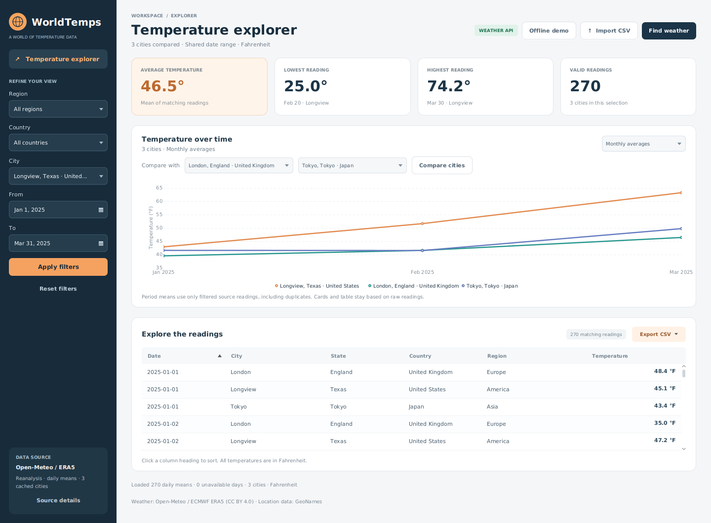
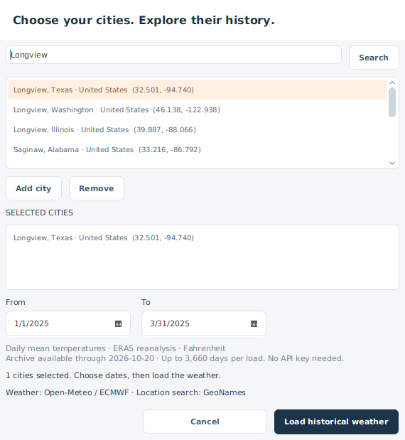

# WorldTemps

A Java temperature explorer with a JavaFX desktop dashboard and a reusable analysis
core. Filter daily readings by location and date, compare cities, aggregate trends,
and export the results. Historical weather comes from Open-Meteo, with CSV import
and an offline demo also available. This project began as linked-list coursework and now retains
that foundation behind a separate presentation and query layer.



The preview shows ERA5 daily means for Longview, London, and Tokyo, January–March
2025, fetched from Open-Meteo and reused from the validated local cache.

## Run the desktop app

Requirements: **JDK 17+**, **Maven 3.9+**, and a graphical desktop session.
Maven downloads the JavaFX libraries for your operating system.

```sh
mvn clean verify
mvn javafx:run
```

The app opens **Find historical weather**. Search for a city, select the correct
state/country and coordinates, and add up to three locations. Choose the date range,
then load. No API key or account is needed for the free noncommercial endpoint.



**Find weather** reopens this dialog at any time. **Import CSV** loads local data.
**Offline demo** loads 270 invented Fahrenheit readings for Longview, London, and
Tokyo; those values are clearly labeled synthetic and are not historical observations.

### Weather API behavior

- City search uses Open-Meteo's GeoNames geocoding endpoint, then requests ERA5 daily
  mean temperatures for the selected coordinates, dates, and timezone.
- Data is **historical reanalysis**, not a live forecast or a direct station record.
  Minimum/maximum cards are extrema of daily mean readings, not daily high/low temperatures.
- Dates run from January 1, 1940 through six days before the current UTC date. ERA5
  is published with a five-day delay; the application keeps one additional day of
  margin. Each load is limited to 3,660 days and three cities.
- API temperatures are requested in Fahrenheit. Responses are checked for supported
  units, aligned arrays, valid/unique dates, finite numbers, and the requested range.
  Celsius responses are converted explicitly. Null or absent days are counted as
  unavailable and are never substituted with zero.
- Every selected city must load successfully before replacing the current dataset.
  A failed load preserves the previous view. API datasets replace, rather than blend
  with, CSV or synthetic demo data.
- Region filters for API data use the first IANA timezone component (for example,
  America, Europe, or Asia), not inferred continents. Source details show full
  coordinates, timezone, origin, fetched time, and unavailable-day counts.
- Selected locations with identical city/state/country labels but different
  coordinates are rejected, so the existing comparison model cannot silently merge them.

Searches and loads run off the UI thread. Requests use an 8-second connection
limit and a 15-second request timeout. HTTP 429 and server errors receive one
retry with a delay capped at two seconds; other client errors are not retried.
There is no request on every keystroke: search is an explicit action.

### Cache and offline use

Validated responses are stored under `~/.worldtemps/weather-cache`. Cache keys
include the full request: coordinates, date range, units, timezone, and model.
Weather responses remain fresh for seven days; city searches for thirty days.
Fresh entries are used without an HTTP request. Corrupt entries are ignored.

If a network request fails or the service is unavailable/rate-limited, an older
validated matching weather entry may be used. The app prominently labels this
**OFFLINE CACHE**, retains its original fetched time, and notes that it may be out
of date. Invalid requests, malformed new responses, and cancellation do not silently
fall back to stale data. Failure to write the cache does not discard a successful
weather response; source details report that the cache copy was not saved.

Exact previously loaded ranges work offline; arbitrary new ranges still need the
API. The standalone demo remains available with no prior downloads. Cache files
can be removed when the app is closed to force a new request.

### Dashboard features

- Region and country filters narrow the available city choices.
- City labels include state and country to distinguish identical names.
- Inclusive date filters; blank dates mean no date bound.
- Average, minimum, maximum, and count cards calculated from the same filtered
  readings shown in the table.
- Compare up to three cities with distinct chart colors and a legend.
- Switch between raw readings, daily means, monthly means, and yearly means.
- Hover for period averages, extrema, and source-reading counts.
- Export filtered readings or chart data as CSV.
- A sortable table with numeric temperature sorting and calendar date sorting.
- Clear empty results, invalid-date feedback, reset, and demo reload controls.
- Keyboard-accessible standard controls and a scrollable layout for smaller windows.

Change your filters, then click **Apply filters**. **Reset filters** shows all
matching locations. When All cities is selected, summaries and the table include
all matches, while the chart asks you to select a city rather than connecting
unrelated locations into one trend.

### Compare and aggregate

Select a primary city, choose up to two additional cities under **Compare with**,
then click **Compare cities** (or **Apply filters**). City choices respect the region
and country filters. To compare countries, leave Country set to All countries;
for comparisons across regions, also choose All regions. Repeated selections are
counted once, and every city uses the same inclusive date range.

The resolution selector changes the chart immediately. Cards and the table always
summarize the selected **raw source readings**. Their combined mean is weighted by
source records, not equally by city. Period means are also calculated directly from
source records, not by averaging monthly means into yearly values.

Missing dates and periods are not filled with zero. Duplicate source records remain
part of the averages and counts. A date filter can select only part of a month or
year; that bucket uses only the included readings. Period start/end labels identify
the calendar bucket, not a guarantee that every date in that bucket was observed.
Raw/daily charts use actual day spacing; monthly/yearly charts use calendar periods.

The plot shows at most the first 1,000 points **per city**, with an explicit notice
when limited. Table rows, summary cards, and exports still include all matching data.

### Export CSV

Use **Export CSV** above the table:

- **Filtered readings** exports every displayed raw row in the table's current sort
  order using the input CSV schema, so the file can be imported back into WorldTemps.
- **Chart data** exports all selected series at the current resolution, including
  points beyond the plot limit. Columns are Country, State, City, Resolution,
  PeriodStart, PeriodEnd, AverageTemperatureF, MinimumTemperatureF,
  MaximumTemperatureF, and ReadingCount. This analysis format is distinct from the
  raw import format.

Exports use UTF-8, ISO dates for chart periods, decimal points independent of system
locale, and standard CSV quoting. Files are written in the background to a temporary
file and replaced only after the complete write succeeds. Failed exports show an
error and preserve the dashboard view.

## Console interface

The existing console workflow remains available as a separate executable JAR:

```sh
mvn clean verify
java -jar target/worldtemps.jar
java -jar target/worldtemps.jar /path/to/city_temperature.csv
java -jar target/worldtemps.jar --help
```

The JAR bundles its CSV dependencies and demo data, so it works from any working
directory. It is the **console** distribution; use `mvn javafx:run` for the desktop
interface. A native desktop installer is not included in this milestone.

## CSV contract

UTF-8 CSV with a header containing these columns. Order and capitalization may vary:

```csv
Region,Country,State,City,Month,Day,Year,AvgTemperature
North America,US,Texas,Longview,1,1,2025,45.0
Europe,UK,,London,1,1,2025,38.0
```

Temperatures are interpreted as **Fahrenheit**. The original dataset's `-99`
missing-temperature marker is excluded. An actual value of -99 °F therefore cannot
be imported using this format; other finite negative temperatures are valid.
Dates must be calendar-valid. Region, country, and city are required; state may be
blank. Location labels are matched as supplied (`US` and `United States` are
separate labels).

Quoted commas and escaped quotes are supported. Invalid individual records are
skipped and counted. Missing required headers or malformed CSV quoting fail the
import. **Import details** shows up to 20 diagnostic examples. Record numbers count
the header as record 1, not physical lines when quoted fields contain newlines.

## Design

| Component | Responsibility |
| --- | --- |
| `model/Reading` | Immutable location, date, and Fahrenheit temperature |
| `collection/ReadingList` | Custom linked-list nodes, append, and iteration |
| `importer/CsvTemperatureLoader` | CSV parsing and validation diagnostics |
| `service/TemperatureData` | Core extrema and city-history queries |
| `service/DashboardQuery` | Shared filters, location options, and summary calculations |
| `service/TemperatureAnalysis` | Per-city daily, monthly, and yearly aggregation |
| `exporter/CsvExporter` | Raw and analysis CSV exports |
| `weather/OpenMeteoClient` | Geocoding, response validation, dates, units, and cache policy |
| `weather/HttpWeatherTransport` | HTTP timeouts and bounded retry |
| `weather/WeatherCache` | Exact-request disk cache |
| `ui/WeatherLoadDialog` | City search, explicit selection, and archive dates |
| `ui/DashboardView` | JavaFX controls, presentation, and background import orchestration |
| `ui/TemperatureDashboard` | Desktop application lifecycle |
| `WorldTemps` | Console entry point |

The custom linked list preserves the project's data-structures foundation without
coupling mutable nodes to reading records. The query layer contains no JavaFX code
and returns immutable results. Imports hold data in memory; filters scan the data
and sort matches chronologically. This milestone makes no large-dataset performance
claims. The original coursework remains available in Git history.

## Validation

```sh
# 69 unit and console regression tests; no graphical session required
mvn clean verify

# Plus 14 integration tests against real JavaFX controls; requires a display
mvn -Pui-tests clean verify

# Linux CI / headless desktop environment
xvfb-run -a mvn -Pui-tests clean verify
```

Tests run without external API calls: weather payloads are explicit invented fixtures,
and HTTP transport tests use a local test server. A separate live smoke check loaded
three geocoded cities and 270 ERA5 daily means, then verified cache-only reuse.

The UI tests exercise filter/card/chart/table consistency, date validation, reset,
empty matches, sorting, import recovery, multi-city comparisons, resolution changes,
export success/failure, and layout. Unit tests also verify leap years, year
boundaries, weighted means, partial periods, quoted Unicode CSV round trips, and
failed destination cleanup, request timeouts/retries, response validation, unit conversion,
cache freshness, corrupt entries, offline provenance, and weather-load recovery.
UI tests also fail on uncaught JavaFX application-thread errors. Screenshots of the running dashboard
and city comparisons are generated in `target/ui/`. GitHub Actions builds the app, smoke
tests the console JAR, runs JavaFX tests under Xvfb, and uploads the preview.

Linux desktops need GTK 3 and X11 libraries. On Ubuntu 24.04, install
`libgtk-3-0t64 libxtst6`; headless tests also require `xvfb`.

## Weather data attribution

Weather data: [Open-Meteo Historical Weather API](https://open-meteo.com/en/docs/historical-weather-api)
and ECMWF ERA5 reanalysis, under [CC BY 4.0](https://creativecommons.org/licenses/by/4.0/).
The app processes daily mean temperature data into comparisons and averages and
may convert Celsius to Fahrenheit. Location search data is based on
[GeoNames](https://www.geonames.org/) via the
[Open-Meteo Geocoding API](https://open-meteo.com/en/docs/geocoding-api).
See [Open-Meteo's terms](https://open-meteo.com/en/terms) for the free endpoint's
noncommercial-use and request limits.

API screenshots show fetched historical data; the offline demo and unit-test
responses are synthetic and labeled accordingly. This application does not
provide a current-weather or forecast view.

## Remaining work

Pending approval: measured performance improvements for larger datasets, desktop
release packaging, and final resume/demo polish. No performance benchmark claims
or native installer are included in this milestone.
